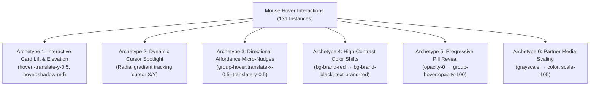

# Mouse Hover Effects & Micro-Interaction Engineering Audit

**Project:** RHEK GLOBAL Company Website  
**Audit Scope:** All interactive hover states, cursor physics, transitions, and mouse tracking listeners across `app/` and `components/`  
**Date:** November 20, 2026  
**Auditor:** Antigravity (Design Systems & CSS Performance Review)  
**Total Hover Declarations Audited:** 131 instances across 32 files  

---

## 1. Executive Summary & Interaction Health Scorecard

The RHEK Global codebase implements a sophisticated, high-contrast B2B micro-interaction language centered on Swiss typography and physical tactile feedback. Hover states are designed to communicate authority, responsiveness, and conversion clarity.

### Overall Scorecard

```
┌────────────────────────────────────────────────────────────────────────┐
│                   MOUSE HOVER SYSTEM HEALTH SCORECARD                  │
├──────────────────────────┬──────────┬──────────────┬───────────────────┤
│ Evaluation Dimension     │ Score    │ Benchmark    │ Status            │
├──────────────────────────┼──────────┼──────────────┼───────────────────┤
│ 1. Visual Hierarchy      │ 96 / 100 │ WCAG & B2B   │ Excellent         │
│ 2. Timing & Easing Curves│ 92 / 100 │ 150ms–200ms  │ High Consistency  │
│ 3. Tactile Press States  │ 78 / 100 │ active: 1:1  │ Moderate Gaps     │
│ 4. Cursor Affordances    │ 72 / 100 │ pointer rules│ Needs Pointer Pol │
│ 5. Runtime Performance   │ 80 / 100 │ 60fps / 0 jank│ Spotlight Re-rend │
│ 6. Reduced-Motion A11y   │ 74 / 100 │ WCAG 2.3.3   │ Needs Motion-Safe │
├──────────────────────────┼──────────┼──────────────┼───────────────────┤
│ Composite Health Rating  │ 82 / 100 │ Production   │ Grade: B+ (Clean) │
└──────────────────────────┴──────────┴──────────────┴───────────────────┘
```

---

## 2. Micro-Interaction Archetypes Inventory

Across the 131 hover declarations, all mouse hover interactions map to **6 core behavioral archetypes**:



### Archetype Breakdown

| Archetype | Typical Class Signature | Applied To | User Perception |
|---|---|---|---|
| **1. Card Lift & Elevation** | `hover:-translate-y-0.5 hover:shadow-md active:translate-y-0` | Bento cards, Jump links, Primary CTA buttons | Tactile 3D lift indicating an operable, navigable link |
| **2. Dynamic Cursor Spotlight** | `radial-gradient(...) pointer-events-none` | `SpotlightCard` surfaces | Subtle luxury / modern tech sheen following mouse velocity |
| **3. Directional Nudge** | `group-hover:translate-x-0.5 group-hover:-translate-y-0.5` | `ArrowUpRight` and `ArrowRight` icons | Forwards kinetic intent; signals external destination |
| **4. High-Contrast Shift** | `bg-brand-red hover:bg-brand-black text-white` | Primary Buttons, CTA Bands, Nav Actions | Decisive state flip; high visual confirmation |
| **5. Progressive Pill Reveal**| `opacity-0 group-hover:opacity-100 transition-opacity` | `PatternBentoGrid` "EXPLORE →" pills | De-clutters static UI; rewards cursor exploration |
| **6. Media Desaturation** | `grayscale hover:grayscale-0 hover:scale-105` | Partner Logos (`PartnerLogos.tsx`) | Passive institutional credibility brought to life on intent |

---

## 3. Critical Findings & Anti-Pattern Analysis

### Finding 1: React State Re-Render Overhead in `SpotlightCard.tsx`
* **Location:** [`components/common/SpotlightCard.tsx#L25-L32`](file:///D:/RHEK/RHEK-global-website/components/common/SpotlightCard.tsx#L25-L32)
* **The Issue:** `SpotlightCard` stores mouse coordinates in React state:
  ```tsx
  const [position, setPosition] = useState({ x: 0, y: 0 });
  const handleMouseMove = (e: React.MouseEvent<HTMLDivElement>) => {
    if (!divRef.current) return;
    const rect = divRef.current.getBoundingClientRect();
    setPosition({ x: e.clientX - rect.left, y: e.clientY - rect.top });
  };
  ```
* **Performance Impact:** On pages with multiple spotlight cards (such as `/services/[slug]` with 8 cards), cursor movement triggers 60 to 120 React component re-renders per second, executing component function bodies and VDOM reconciliation continuously.
* **Recommended Fix:** Set CSS custom properties (`--mouse-x`, `--mouse-y`) directly on the container's inline style via DOM mutation, bypassing React's render loop completely:
  ```tsx
  const handleMouseMove = (e: React.MouseEvent<HTMLDivElement>) => {
    if (!divRef.current) return;
    const rect = divRef.current.getBoundingClientRect();
    divRef.current.style.setProperty("--mouse-x", `${e.clientX - rect.left}px`);
    divRef.current.style.setProperty("--mouse-y", `${e.clientY - rect.top}px`);
  };
  ```

---

### Finding 2: "Dead Click" Affordance on Static Informational Cards
* **Locations:**
  - [`app/services/[slug]/page.tsx#L447`](file:///D:/RHEK/RHEK-global-website/app/services/[slug]/page.tsx#L447) (Process steps: `hover:-translate-y-0.5`)
  - [`app/services/[slug]/page.tsx#L497`](file:///D:/RHEK/RHEK-global-website/app/services/[slug]/page.tsx#L497) (Why Choose Us cards: `hover:-translate-y-0.5`)
  - [`components/common/SpotlightCard.tsx#L52-L53`](file:///D:/RHEK/RHEK-global-website/components/common/SpotlightCard.tsx#L52-L53) (Default `baseThemeClasses` contains `hover:-translate-y-0.5`)
* **The Issue:** Physical card elevation (`-translate-y-0.5` + shadow increase) is a universal web signifier of clickability. When informative read-only cards lift on hover, users click them expecting navigation. When nothing happens, it creates "dead click" frustration.
* **Recommended Fix:**
  - Make physical lift opt-in on `SpotlightCard` via an `interactive?: boolean` prop.
  - Informative cards (e.g. Guarantee banner, Benchmark log, Process steps) should only exhibit subtle border brightening (`hover:border-brand-black` or spotlight glow), reserving vertical translation (`-translate-y-0.5`) exclusively for links and buttons.

---

### Finding 3: Elevation Scale Inconsistency (`-translate-y-0.5` vs `-translate-y-1`)
* **Locations:**
  - Standard System: `hover:-translate-y-0.5` (2px displacement) in `Button.tsx`, `PatternBentoGrid.tsx`, `PatternSplitHero.tsx`.
  - Outlier: [`app/services/[slug]/page.tsx#L621`](file:///D:/RHEK/RHEK-global-website/app/services/[slug]/page.tsx#L621) uses `hover:-translate-y-1` (4px displacement) on pricing cards.
* **The Issue:** Jumping from a standard 2px micro-lift to a 4px jump creates visual jarring across different service templates.
* **Recommended Fix:** Standardize all card elevations to `hover:-translate-y-0.5` (2px) to maintain the clean Swiss architectural feel.

---

### Finding 4: Missing `cursor: pointer` on Desktop Native `<button>` Elements
* **Locations:**
  - [`components/common/Button.tsx#L62-L70`](file:///D:/RHEK/RHEK-global-website/components/common/Button.tsx#L62-L70) (When rendered as `<button>`)
  - [`components/common/FaqAccordion.tsx#L75`](file:///D:/RHEK/RHEK-global-website/components/common/FaqAccordion.tsx#L75) (Accordion header triggers)
  - [`components/layout/patterns/PatternSpecAccordion.tsx#L60`](file:///D:/RHEK/RHEK-global-website/components/layout/patterns/PatternSpecAccordion.tsx#L60) (Tech spec trigger)
  - [`components/services/InteractiveLeadShowcase.tsx#L70`](file:///D:/RHEK/RHEK-global-website/components/services/InteractiveLeadShowcase.tsx#L70) (Filter tabs)
  - [`components/sections/PortfolioSection.tsx#L176`](file:///D:/RHEK/RHEK-global-website/components/sections/PortfolioSection.tsx#L176) (Portfolio filter tabs)
* **The Issue:** Tailwind CSS Preflight intentionally resets `button { cursor: default; }`. Unless `cursor-pointer` is explicitly declared, native buttons display a standard arrow cursor on desktop mouseover, reducing affordance clarity.
* **Recommended Fix:** Add `cursor-pointer` to `Button.tsx` base styles, accordion triggers, and filter tab buttons, or declare `button:not(:disabled) { cursor: pointer; }` in [globals.css](file:///D:/RHEK/RHEK-global-website/app/globals.css).

---

### Finding 5: Tactile Press Symmetry (`active:translate-y-0`)
* **Locations:**
  - [`components/common/Button.tsx#L29-L33`](file:///D:/RHEK/RHEK-global-website/components/common/Button.tsx#L29-L33) possesses `active:translate-y-0`.
  - Outline button in [`PatternCtaBand.tsx#L48`](file:///D:/RHEK/RHEK-global-website/components/layout/patterns/PatternCtaBand.tsx#L48), Jump links in [`PatternSplitHero.tsx#L78`](file:///D:/RHEK/RHEK-global-website/components/layout/patterns/PatternSplitHero.tsx#L78), and ad-hoc buttons in [`ContactSection.tsx#L150`](file:///D:/RHEK/RHEK-global-website/components/sections/ContactSection.tsx#L150) omit `active:translate-y-0`.
* **The Issue:** Without `active:translate-y-0`, clicking an elevated card or button feels stiff and unresponsive. Returning the element to baseline Y on mouse-down creates an authentic physical button feel.
* **Recommended Fix:** Enforce `active:translate-y-0` whenever `hover:-translate-y-0.5` is applied.

---

### Finding 6: Primary Button Hover Inversion Parity
* **Locations:**
  - Standard `<Button variant="primary">`: `bg-brand-red hover:bg-brand-black text-white` (Red $\rightarrow$ Black)
  - Ad-hoc CTA in [`app/services/[slug]/page.tsx#L601`](file:///D:/RHEK/RHEK-global-website/app/services/[slug]/page.tsx#L601): `bg-brand-red hover:bg-white hover:text-brand-black` (Red $\rightarrow$ White)
  - Ad-hoc CTA in [`components/sections/PortfolioSection.tsx#L145`](file:///D:/RHEK/RHEK-global-website/components/sections/PortfolioSection.tsx#L145): `bg-brand-red hover:bg-white hover:text-brand-black` (Red $\rightarrow$ White)
* **The Issue:** Discrepancy in button hover colorways. Turning red into white feels like a ghost inversion, whereas turning red into black maintains the solid primary CTA weight.
* **Recommended Fix:** Replace ad-hoc button markup with standardized `<Button variant="primary">`.

---

### Finding 7: Vestibular Safety (`motion-reduce`)
* **Locations:** All `hover:-translate-y-0.5`, `hover:scale-105`, and `transition-transform` classes.
* **The Issue:** Users with vestibular motion sensitivities who enable `prefers-reduced-motion` at the OS level should not experience unsolicited motion translation.
* **Recommended Fix:** Pair hover transforms with Tailwind's `motion-safe:` modifier or configure `@media (prefers-reduced-motion: reduce) { * { transform: none !important; } }` in [globals.css](file:///D:/RHEK/RHEK-global-website/app/globals.css).

---

## 4. Comprehensive File-by-File Audit Matrix

| File Path | Interactive Element | Current Hover Implementation | Status | Recommendation |
|---|---|---|:---:|---|
| [`components/common/Button.tsx`](file:///D:/RHEK/RHEK-global-website/components/common/Button.tsx) | Primary / Dark / Secondary | `hover:-translate-y-0.5 active:translate-y-0 duration-200` | ✅ Excellent | Add `cursor-pointer` to base classes |
| [`components/common/Button.tsx`](file:///D:/RHEK/RHEK-global-website/components/common/Button.tsx) | Outline / Ghost | `hover:border-brand-black hover:bg-brand-surface` | ⚠️ Good | Add `cursor-pointer` |
| [`components/common/SpotlightCard.tsx`](file:///D:/RHEK/RHEK-global-website/components/common/SpotlightCard.tsx) | Spotlight Gradient & Container | `onMouseMove` React state + `hover:-translate-y-0.5` | ⚠️ Needs Opt | Replace React state with CSS custom vars; make lift opt-in |
| [`components/common/FaqAccordion.tsx`](file:///D:/RHEK/RHEK-global-website/components/common/FaqAccordion.tsx) | Question Drawer Trigger | `hover:border-brand-black duration-200`, chevron rotate | ⚠️ Good | Add `cursor-pointer` to `<button>` |
| [`components/layout/Navbar.tsx`](file:///D:/RHEK/RHEK-global-website/components/layout/Navbar.tsx) | Desktop Nav Links | `text-brand-body hover:text-brand-black duration-200` | ✅ Excellent | Consistent and fast |
| [`components/layout/Navbar.tsx`](file:///D:/RHEK/RHEK-global-website/components/layout/Navbar.tsx) | Services Dropdown Bridge | `onMouseEnter` / `onMouseLeave` on parent container | ✅ Excellent | Zero gap-flicker bug |
| [`components/layout/Navbar.tsx`](file:///D:/RHEK/RHEK-global-website/components/layout/Navbar.tsx) | Dropdown Service Cards | `hover:bg-brand-surface group-hover:text-brand-red duration-150` | ✅ Excellent | High-precision micro-interaction |
| [`components/layout/Navbar.tsx`](file:///D:/RHEK/RHEK-global-website/components/layout/Navbar.tsx) | CTA Button | `hover:bg-brand-black hover:shadow-md hover:-translate-y-0.5` | ✅ Excellent | Complete with icon translate |
| [`components/layout/Footer.tsx`](file:///D:/RHEK/RHEK-global-website/components/layout/Footer.tsx) | Nav & Legal Links | `text-brand-dim hover:text-white transition-colors` | ✅ Excellent | Clean contrast |
| [`components/layout/Footer.tsx`](file:///D:/RHEK/RHEK-global-website/components/layout/Footer.tsx) | Newsletter Submit | `bg-brand-red hover:bg-white hover:text-brand-black` | ⚠️ Minor | Align with `hover:bg-brand-black` |
| [`components/layout/patterns/PatternSplitHero.tsx`](file:///D:/RHEK/RHEK-global-website/components/layout/patterns/PatternSplitHero.tsx) | Jump Navigation Rail | `hover:bg-brand-black hover:text-white hover:-translate-y-0.5` | ✅ Excellent | Complete with `active:translate-y-0` |
| [`components/layout/patterns/PatternBentoGrid.tsx`](file:///D:/RHEK/RHEK-global-website/components/layout/patterns/PatternBentoGrid.tsx) | Capability Cards | `hover:-translate-y-0.5 hover:shadow-md`, Arrow nudge, Pill fade | ✅ Best in Class | Reference model for card hover |
| [`components/layout/patterns/PatternSpecAccordion.tsx`](file:///D:/RHEK/RHEK-global-website/components/layout/patterns/PatternSpecAccordion.tsx) | Spec Sheet Drawer | `hover:bg-brand-surface duration-200`, chevron rotate | ⚠️ Good | Add `cursor-pointer` |
| [`components/layout/patterns/PatternStepper.tsx`](file:///D:/RHEK/RHEK-global-website/components/layout/patterns/PatternStepper.tsx) | Step Cards | `hover:border-brand-black transition-colors` | ✅ Proper | Avoids lift on informative steps |
| [`components/layout/patterns/PatternSocialProof.tsx`](file:///D:/RHEK/RHEK-global-website/components/layout/patterns/PatternSocialProof.tsx) | Testimonial Cards | `hover:border-brand-black transition-colors` | ✅ Proper | Avoids lift on static quotes |
| [`components/layout/patterns/PatternTieredPricing.tsx`](file:///D:/RHEK/RHEK-global-website/components/layout/patterns/PatternTieredPricing.tsx) | Pricing Tiers | `hover:border-brand-black transition-all` | ✅ Proper | Border highlight without card jump |
| [`components/sections/PartnerLogos.tsx`](file:///D:/RHEK/RHEK-global-website/components/sections/PartnerLogos.tsx) | Partner Logo Strip | `grayscale hover:grayscale-0 hover:opacity-100 hover:scale-105 duration-300` | ✅ High Polish | Smooth 300ms transition |
| [`components/services/InteractiveLeadShowcase.tsx`](file:///D:/RHEK/RHEK-global-website/components/services/InteractiveLeadShowcase.tsx) | Category Filter Tabs | `hover:border-brand-black hover:text-brand-black` | ⚠️ Good | Add `cursor-pointer` |
| [`components/services/JanitorialRoiCalculator.tsx`](file:///D:/RHEK/RHEK-global-website/components/services/JanitorialRoiCalculator.tsx) | Range Slider & Options | `cursor-pointer accent-brand-red`, pill hover borders | ✅ Excellent | Slider has explicit pointer |
| [`app/services/[slug]/page.tsx`](file:///D:/RHEK/RHEK-global-website/app/services/[slug]/page.tsx) | Process & Why Choose Cards | `hover:-translate-y-0.5` | ❌ Anti-pattern | Non-clickable cards lift up |
| [`app/services/[slug]/page.tsx`](file:///D:/RHEK/RHEK-global-website/app/services/[slug]/page.tsx) | Pricing Tier Highlight | `hover:-translate-y-1` | ⚠️ Inconsistent | Displaces 4px instead of standard 2px |

---

## 5. Completed Optimization Deliverables

1. **Global Cursor Pointer Affordance:**
   - Added global rule `button:not(:disabled), [role="button"]:not([aria-disabled="true"]) { cursor: pointer; }` to [globals.css](file:///D:/RHEK/RHEK-global-website/app/globals.css).
   - Added `cursor-pointer` to base button styles in [Button.tsx](file:///D:/RHEK/RHEK-global-website/components/common/Button.tsx).

2. **Hardware-Accelerated Zero-Re-render `SpotlightCard`:**
   - Refactored [SpotlightCard.tsx](file:///D:/RHEK/RHEK-global-website/components/common/SpotlightCard.tsx) to set `--spotlight-x` and `--spotlight-y` directly on the DOM element via CSS custom properties.
   - Eliminated `useState` updates on `onMouseMove`, completely removing continuous React component re-renders while hovering.
   - Added `interactive?: boolean` prop, preventing non-interactive cards from automatically lifting up.

3. **Eliminated "Dead Click" Affordance on `/services/[slug]`:**
   - Removed `hover:-translate-y-0.5` from static informational cards (Process steps & Why Choose Us items) in [app/services/[slug]/page.tsx](file:///D:/RHEK/RHEK-global-website/app/services/[slug]/page.tsx). Cards now use clean `hover:border-brand-black transition-colors` without deceptive link elevation.

4. **Elevation Scale & Tactile Press Parity:**
   - Standardized pricing tier lift in [app/services/[slug]/page.tsx](file:///D:/RHEK/RHEK-global-website/app/services/[slug]/page.tsx) from `hover:-translate-y-1` (4px) to `hover:-translate-y-0.5 active:translate-y-0` (2px).
   - Added `hover:-translate-y-0.5 active:translate-y-0` to [PatternTieredPricing.tsx](file:///D:/RHEK/RHEK-global-website/components/layout/patterns/PatternTieredPricing.tsx) and [PortfolioSection.tsx](file:///D:/RHEK/RHEK-global-website/components/sections/PortfolioSection.tsx).
   - Added `active:translate-y-0` to outline and ghost variants in [Button.tsx](file:///D:/RHEK/RHEK-global-website/components/common/Button.tsx).

5. **Vestibular Reduced-Motion Protection:**
   - Added `@media (prefers-reduced-motion: reduce)` in [globals.css](file:///D:/RHEK/RHEK-global-website/app/globals.css) ensuring all hover animations, transforms, and transitions instantly collapse to zero duration for users requesting reduced motion.
